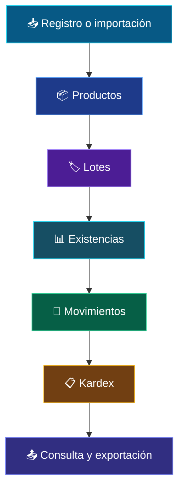
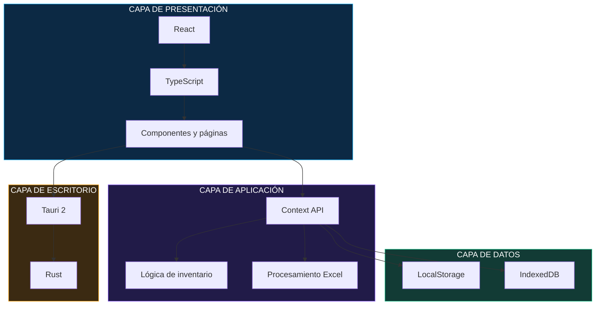

 <div align="center">


<br/>


### SISTEMA DE GESTIÓN Y CONTROL DE ALMACÉN

*Tecnología, organización y trazabilidad para una gestión eficiente del inventario.*

[FUNCIONALIDADES](#-módulos-del-sistema) · [TECNOLOGÍAS](#-tecnologías) · [INSTALACIÓN](#-instalación)

</div>

---

## 🔷 01 — PRESENTACIÓN DEL PROYECTO

**INAMBU WMS** es una aplicación de escritorio desarrollada para gestionar y controlar las operaciones de almacén.

Su propósito es centralizar la información de productos, lotes, proveedores y movimientos de inventario, permitiendo realizar un seguimiento organizado de las existencias y conservar la trazabilidad de las operaciones.

<details>
<summary><strong>🎯 Objetivos del sistema</strong></summary>

- Organizar la información de los productos.
- Controlar las existencias mediante lotes.
- Registrar entradas, salidas y otros movimientos.
- Supervisar fechas de producción y vencimiento.
- Consultar el historial de operaciones.
- Facilitar el intercambio de información mediante Excel.

</details>

---

## ⚡ 02 — MÓDULOS DEL SISTEMA

<table>
<tr>
<td width="50%" valign="top">

### 

**Gestión de productos**

Administración del catálogo de productos, códigos, presentaciones y datos relacionados con el inventario.

</td>
<td width="50%" valign="top">

### 

**Control de lotes**

Registro de cantidades, números de lote, fechas de ingreso, producción y vencimiento.

</td>
</tr>
<tr>
<td width="50%" valign="top">

### 

**Operaciones de inventario**

Registro de entradas, salidas, ajustes y devoluciones, manteniendo el seguimiento de las existencias.

</td>
<td width="50%" valign="top">

### 

**Gestión de proveedores**

Administración de información de proveedores y asociación con los registros de inventario.

</td>
</tr>
<tr>
<td width="50%" valign="top">

### 

**Historial de movimientos**

Consulta de operaciones y seguimiento de las variaciones de existencias.

</td>
<td width="50%" valign="top">

### 

**Importación y exportación**

Procesamiento de hojas de cálculo para incorporar y consultar información.

</td>
</tr>
<tr>
<td colspan="2">

### 

**Administración de registros eliminados**

Gestión de registros enviados a la papelera y opciones de recuperación disponibles.

</td>
</tr>
</table>

---

## 🧠 03 — CONTROL INTELIGENTE DE INVENTARIO

El sistema relaciona los productos con sus lotes para facilitar el seguimiento de cantidades y movimientos.

| Indicador | Descripción |
|:---|:---|
| 🟢 **VIGENTE** | Lote dentro de su periodo de validez. |
| 🟠 **POR VENCER** | Lote próximo a su fecha de vencimiento. |
| 🔴 **VENCIDO** | Lote cuya fecha de vencimiento ha sido superada. |
| ⚫ **AGOTADO** | Lote sin existencias disponibles. |

### Flujo de operaciones



---

## 🏗️ 04 — ARQUITECTURA DEL SOFTWARE

La aplicación está organizada en capas que separan la interfaz, la lógica de negocio y el almacenamiento local.



### Organización de tecnologías

| Tecnología | Responsabilidad |
|---|---|
| React 19 | Construcción de la interfaz. |
| TypeScript | Tipado y organización del código. |
| Vite | Desarrollo y compilación frontend. |
| Tauri 2 | Integración como aplicación de escritorio. |
| Rust | Capa nativa de Tauri. |
| Context API | Administración del estado global. |
| LocalStorage | Persistencia local. |
| IndexedDB | Almacenamiento local de archivos y datos. |
| SheetJS (XLSX) | Lectura y procesamiento de Excel. |
| Recharts | Visualización de datos. |
| jsPDF | Generación de documentos PDF. |

---

## 📁 05 — ESTRUCTURA DEL PROYECTO

```text
INAMBU-WMS/
│
├── assets/
│   └── inambu-banner.svg
│
├── src/
│   ├── components/       # Componentes reutilizables
│   ├── pages/            # Módulos y pantallas
│   ├── store/            # Estado y lógica de aplicación
│   ├── lib/              # Funciones auxiliares
│   ├── assets/           # Recursos gráficos
│   ├── App.tsx
│   └── main.tsx
│
├── src-tauri/
│   ├── src/              # Código nativo Rust
│   ├── icons/            # Iconos de escritorio
│   └── tauri.conf.json
│
├── public/
├── index.html
├── package.json
├── vite.config.ts
└── README.md
```

<sub>La estructura es referencial y puede variar según la organización actual del código fuente.</sub>

---

## 💻 06 — INSTALACIÓN

### Requisitos previos

| Herramienta | Función |
|---|---|
| Node.js | Entorno de ejecución. |
| pnpm | Gestor de paquetes. |
| Rust | Desarrollo nativo. |
| Cargo | Gestión de dependencias Rust. |

### 01. Clonar el repositorio

```bash
git clone https://github.com/andremezabarriga314/Sistema_de_Almacenes.git

cd Sistema_de_Almacenes
```

### 02. Instalar dependencias

```bash
pnpm install
```

### 03. Ejecutar frontend

```bash
pnpm dev
```

### 04. Ejecutar aplicación de escritorio

```bash
pnpm tauri dev
```

---

## 📦 07 — COMPILACIÓN PARA WINDOWS

Para generar la aplicación de escritorio:

```bash
pnpm tauri build
```

Los instaladores se generan en:

```text
src-tauri/target/release/bundle/
```

Los formatos disponibles dependen de la configuración de compilación de Tauri.

---

## 🔐 08 — CONSIDERACIONES TÉCNICAS

- Aplicación orientada a escritorio.
- Almacenamiento de información local.
- Procesamiento de archivos Excel.
- Gestión de relaciones entre productos, lotes y movimientos.
- Se recomienda realizar copias de seguridad periódicas.

---

## 👨‍💻 09 — DESARROLLADOR

<div align="center">

### ANDRÉ MEZA BARRIGA

**Ingeniería de Software con Inteligencia Artificial**

[](https://github.com/andremezabarriga314)

[](https://linkedin.com/in/andremezabarriga)

<br/>

**INAMBU WMS**

*Gestión inteligente. Control preciso. Trazabilidad.*

</div>