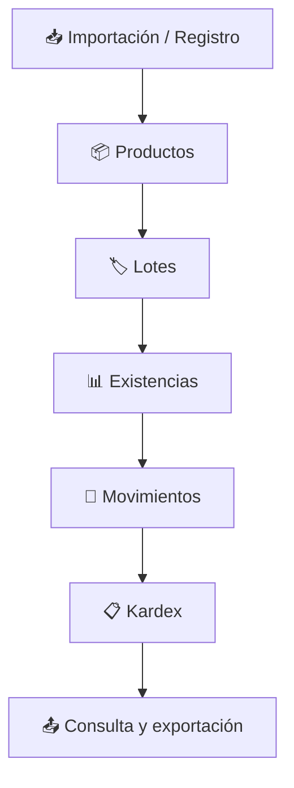
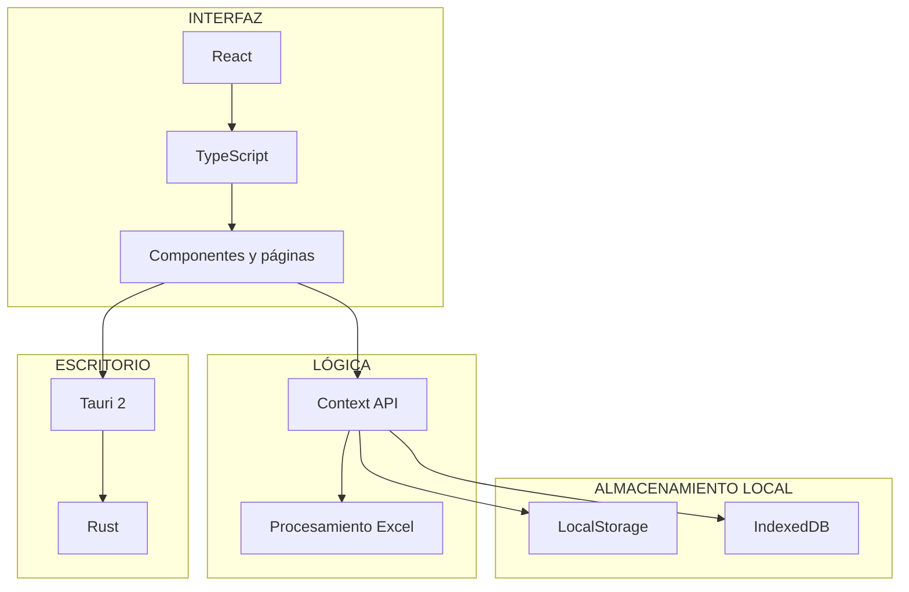

 <div align="center">


**Sistema de Gestión y Control de Almacén para Windows**

[Funcionalidades](#-funcionalidades) · [Arquitectura](#-arquitectura) · [Instalación](#-instalación)

</div>

---

## 🔷 Acerca del proyecto

**INAMBU WMS** es una aplicación de escritorio desarrollada para gestionar las operaciones de almacén. Permite controlar productos, lotes, proveedores y movimientos de inventario, manteniendo la trazabilidad de las existencias.

Su objetivo es facilitar el registro, seguimiento y consulta de información mediante una interfaz moderna y herramientas de procesamiento de datos.

## ⚡ Funcionalidades

| Módulo | Funcionalidad |
|---|---|
| 📦 Productos | Registro y administración del catálogo de productos. |
| 🏷️ Lotes | Control de cantidades, fechas y vencimientos. |
| 🔄 Movimientos | Entradas, salidas, ajustes y devoluciones. |
| 🏢 Proveedores | Administración de proveedores. |
| 📋 Kardex | Historial y trazabilidad de movimientos. |
| 📊 Excel | Importación y exportación de información. |
| 🗑️ Papelera | Gestión de registros eliminados y recuperación. |

## 🧠 Control de inventario

El sistema relaciona productos con sus lotes para realizar el seguimiento de las existencias.

- Control de cantidades disponibles.
- Registro de fechas de producción y vencimiento.
- Seguimiento de movimientos.
- Identificación de lotes próximos a vencer.
- Consulta del historial de inventario.

### Estados de lotes

| Estado | Descripción |
|---|---|
| 🟢 Vigente | Dentro de su periodo de validez. |
| 🟠 Por vencer | Próximo a su fecha de vencimiento. |
| 🔴 Vencido | Fecha de vencimiento superada. |
| ⚫ Agotado | Sin existencias disponibles. |

## 🔄 Flujo de operaciones



## 🏗️ Arquitectura



## 🧰 Tecnologías

| Tecnología | Aplicación |
|---|---|
| React 19 | Interfaz de usuario. |
| TypeScript | Tipado y organización del código. |
| Vite | Entorno de desarrollo. |
| Tauri 2 | Aplicación de escritorio. |
| Rust | Integración nativa. |
| Context API | Estado global. |
| IndexedDB | Almacenamiento local de archivos y datos. |
| LocalStorage | Persistencia local. |
| SheetJS | Procesamiento de Excel. |
| Recharts | Gráficos y visualización. |
| jsPDF | Generación de PDF. |

## 📁 Estructura del proyecto

```text
INAMBU-WMS/
├── src/
│   ├── components/
│   ├── pages/
│   ├── store/
│   ├── lib/
│   ├── assets/
│   ├── App.tsx
│   └── main.tsx
│
├── src-tauri/
│   ├── src/
│   ├── icons/
│   └── tauri.conf.json
│
├── public/
├── package.json
├── vite.config.ts
└── README.md
```

## 💻 Instalación

**Requisitos:** Node.js, pnpm, Rust y Cargo, además de los requisitos de compilación de Tauri para Windows.

### 1. Clonar el repositorio

```bash
git clone https://github.com/andremezabarriga314/Sistema_de_Almacenes.git
cd Sistema_de_Almacenes
```

### 2. Instalar dependencias

```bash
pnpm install
```

### 3. Ejecutar el frontend

```bash
pnpm dev
```

### 4. Ejecutar la aplicación de escritorio

```bash
pnpm tauri dev
```

## 📦 Compilación para Windows

```bash
pnpm tauri build
```

Los instaladores y archivos de distribución se generan en:

```text
src-tauri/target/release/bundle/
```

## 🔐 Consideraciones

- Aplicación diseñada para escritorio.
- Utiliza almacenamiento local.
- Los archivos Excel deben tener una estructura compatible con el procesamiento implementado.
- Se recomienda realizar copias de seguridad periódicas.

---

<div align="center">

## 👨‍💻 Autor

**ANDRÉ MEZA BARRIGA**

Estudiante de Ingeniería de Software con Inteligencia Artificial

[](https://github.com/andremezabarriga314)

[](https://linkedin.com/in/andremezabarriga)

**INAMBU WMS — Gestión inteligente de almacenes**

</div>